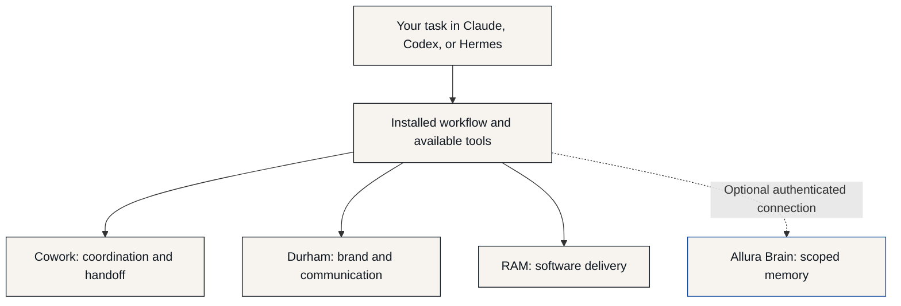

<p align="center">
  
</p>

<h1 align="center">Allura Plugins</h1>

<p align="center">
  <strong>Choose a team. Give it a task. Keep the evidence.</strong><br/>
  Plugins for AI collaboration, brand work, software delivery, and governed memory.
</p>

<p align="center">
  <a href="#catalog">Choose a plugin</a> ·
  <a href="#installation">Install</a> ·
  <a href="#start-in-chat">Start in chat</a> ·
  <a href="#how-the-plugins-fit-together">How it works</a> ·
  <a href="#validation">Release evidence</a> ·
  <a href="#updating-the-catalog">Maintain the catalog</a>
</p>

Allura is the sovereign memory layer for AI. This catalog adds workflows and specialist roles around that foundation. Use it to choose the packages your task needs, install them in a compatible runtime, and understand what each release has actually verified.

## Catalog

Start with **Allura Cowork** for coordination, then add a team or task skill. For Hermes, use the native team plugin and separate memory provider linked below. Install current packages from `main`.

| You want to… | Choose | Runtime |
|---|---|---|
| Plan work, get next steps, or hand off a task | [Allura Cowork](allura-cowork/README.md) | Claude, Codex |
| Develop a brand, write copy, or produce visual assets | [Team Durham](team-durham/README.md) | Claude, Codex |
| Design, build, or review software | [Team RAM Coding](team-ram-coding/README.md) | Claude, Codex |
| Review software supply-chain evidence | [Bumblebee](bumblebee/README.md) | Claude, Codex |
| Use RAM and Durham in Hermes | [Native Hermes teams](https://github.com/Allura-Ecosystem/hermes-team-ram-durham) | Hermes |
| Connect Hermes to scoped Allura memory | [Hermes Allura Brain](plugins/hermes-allura-brain/README.md) | Hermes |
| Turn a rough request into a clear prompt | [Prompt Optimization Bot](plugins/prompt-optimization-bot/README.md) | Claude, Hermes |
| Review a business issue or contract and prepare a counsel brief | [CorpLawyer Bot](plugins/corplawyer-bot/README.md) | Claude, Hermes |
| Check a live app against approved brand rules | [Team Durham App Audit](plugins/team-durham-app-audit/README.md) | Claude, Hermes |
| Review mortgage-file evidence | [Mortagate Cowork](packages/mortagate-cowork/README.md) | Microsoft Cowork / Agent Skills |

Runtime listings describe package targets. Loading, authentication, and optional integrations must be checked in the runtime you use. Installing a plugin does not install every service it can work with.

<details>
<summary>Versions and package definitions</summary>

Counts describe files in this repository, not agents currently installed or running.

| Plugin | Version | Agents | Commands | Skills |
|---|:---:|---:|---:|---:|
| Allura Cowork | 0.4.0 | 1 | 4 | 2 |
| Team Durham | 0.4.3 | 7 | 22 | 77 |
| Team RAM Coding | 0.6.2 | 10 | — | 10 |
| Bumblebee | 0.1.1 | — | 1 | 1 |
| Hermes Allura Brain | 0.3.0 | — | 1 | — |
| Prompt Optimization Bot | 0.33.2 | — | — | 1 |
| CorpLawyer Bot | 0.9.0 | — | — | 6 |
| Team Durham App Audit | 1.0.1 | — | — | 1 |
| Mortagate Cowork | 0.2.1 | — | — | 4 |

The external Hermes team plugin is version `1.3.0`: ten RAM roles, seven Durham roles, and the shared Cowork chat menu. It has its own source repository and installation process.

Claude and Codex share four portable marketplace packages: Cowork, Durham, RAM, and Bumblebee. Claude also lists the three task skill packages for prompts, legal workflows, and app audits. The Hermes memory provider and Microsoft Cowork package use their own runtime contracts.

Team RAM uses the catalog alias `team-ram-coding`; its standalone Claude manifest retains `team-ram-harness`. Codex requires the manifest name to match the catalog alias. [Source locks](source-locks.json) record both identities. RAM exposes ten public skills; Durham retains its command definitions. Codex discovers workflows through skills.

The [`allura/`](allura/README.md) directory is internal support material, not a public marketplace package. The [Allura Framework](https://github.com/Allura-Ecosystem/allura-framework) is a separate private repository requiring its own access.

</details>

## Installation

### Claude marketplace

Add the marketplace and install the packages you want:

```text
/plugin marketplace add Allura-Ecosystem/allura-plugins
/plugin install allura-cowork@allura-ecosystem
/plugin install team-durham@allura-ecosystem
/plugin install team-ram-coding@allura-ecosystem
```

Optional task packages:

```text
/plugin install prompt-optimization-bot@allura-ecosystem
/plugin install corplawyer-bot@allura-ecosystem
/plugin install team-durham-app-audit@allura-ecosystem
```

For an existing installation, refresh the marketplace and update the packages you use:

```text
/plugin marketplace update allura-ecosystem
/plugin update allura-cowork@allura-ecosystem
/plugin update team-ram-coding@allura-ecosystem
/plugin update team-durham@allura-ecosystem
```

Update optional packages the same way, then reload plugins or restart the session as supported by your Claude version. A source merge or marketplace refresh does not refresh every installed cache. The [Claude marketplace manifest](.claude-plugin/marketplace.json) lists available packages.

### Codex

The [Codex marketplace manifest](.agents/plugins/marketplace.json) lists the four portable packages. Each has a `.codex-plugin/plugin.json` manifest. In a compatible Codex environment, clone this repository into your plugin source location, register the package through the supported local-plugin flow, then verify it is available after restart. Catalog membership alone does not establish loading in your session.

### Hermes: Team RAM + Team Durham

Install the [native team plugin](https://github.com/Allura-Ecosystem/hermes-team-ram-durham#install) from its `main` branch. Its Hermes identity is `team-ram-durham`.

```text
/ram activate
/ram <task>
/durham <task>
/ram-woz <task>
/durham-copywriter <task>
```

These commands load role and workflow guidance, then route the task into the current conversation. The active agent uses the configured model and existing permissions. Loading a role does not itself execute the task or launch another agent.

The [Allura Brain provider](plugins/hermes-allura-brain/README.md) is installed and configured separately. [Prompt Bot](plugins/prompt-optimization-bot/README.md), [CorpLawyer](plugins/corplawyer-bot/README.md), and [App Audit](plugins/team-durham-app-audit/README.md) each document their native skill installation and use.

<details>
<summary>Hermes routing and scope reference</summary>

Slash commands use the installed Hermes CLI's message-injection support. A gateway without that support returns a fallback instruction. Send a normal prompt such as: “Use `allura_team` with team `ram`, role `woz`, and task `<task>`, then continue here.” For copy work use team `durham` and role `copywriter`.

Skills register actual `SKILL.md` files under `team-ram-durham:ram-<name>` and `team-ram-durham:durham-<name>`. Entry workflows are `team-ram-durham:ram` and `team-ram-durham:durham`.

The team plugin does not configure the memory provider. Brain calls inherit the authenticated project/task scope. Team defaults (`allura-system` for RAM and `allura-team-durham` for Durham) are hints requiring authorization. A Council specialist inherits the validated task scope; the adapter reports `scope_status: inherit_authenticated_task`. Denied memory does not trigger a tenant or credential fallback.

</details>

### Requirements

| Requirement | When you need it |
|---|---|
| A compatible target runtime | To install and load the selected package |
| Authorized Allura Brain connection | For scoped recall and outcome logging |
| Python 3 | For Cowork's context hook and validation scripts |
| Docker | For workflows that explicitly use MCP Docker or infrastructure tools |
| Figma, Penpot, Notion, fal.ai, or LibreOffice | Only for Durham work using those optional integrations |

Missing tools or authentication must be reported. Work that can use the available inputs may continue with its limits stated.

## Start in chat

Give a clear task directly, or ask for **Menu** or **Help** after loading Cowork or a team entry skill.

| Choice | What you get |
|---|---|
| Next steps | One to three actions, with a recommendation and reason |
| Help with a prompt | A ready-to-use prompt preserving your intent and constraints |
| Council | One decision examined by relevant RAM and Durham specialists, when delegation is available |
| Work | The authorized task carried out and checked |
| Loop | Work, check, and improve within an agreed goal and iteration limit |
| Validate | A comparison with your acceptance criteria and actual evidence |
| More | Available research, memory, skill creation, Party, Setup, and Doctor workflows |

For example: “Use Team Durham to review this README. Make the first step clear, preserve the installation commands, and flag unsupported claims.”

**Next steps** is useful when the idea is still forming. Clear requests proceed directly to **Work**. The menu appears on activation or request; these conversational choices do not imply matching slash commands on every host. Council requires actual delegation. Without it, the agent can prepare a council brief and state that specialists have not run.

## How the plugins fit together



Read from top to bottom: the task uses workflows and tools available in the current runtime. Cowork and the two teams have distinct responsibilities; an authorized Brain connection adds memory. This map describes relationships, not a record of agents or runtimes executing. Sources: [Cowork workflow](allura-cowork/skills/allura-cowork/SKILL.md), [Durham](team-durham/README.md), [RAM](team-ram-coding/README.md), and [Hermes memory provider](plugins/hermes-allura-brain/README.md).

**Cowork coordinates** the task and handoff. **Durham handles brand strategy and production. RAM handles software delivery. Allura Brain supplies governed memory.** Claude, Codex, and Hermes are execution environments with different capabilities.

| Team | Typical workflow |
|---|---|
| Durham | Brief → strategy → positioning → copy and visual direction → production → accessibility and QA |
| RAM | Brooks routes → Scout retrieves context → required skills → implementation and review → validation → outcome |
| Cowork | Project context → route and owner → work and evidence → validated handoff or closeout |

### Source ownership

| Capability | Source authority | Catalog role |
|---|---|---|
| Engineering harness | [Allura Team RAM](https://github.com/Allura-Ecosystem/allura-team-ram) | Generated `team-ram-coding/` export |
| Brand harness | [Team Durham](https://github.com/Allura-Ecosystem/team-durham) | Generated `team-durham/` export |
| Supply-chain evidence review | [Bumblebee](https://github.com/Allura-Ecosystem/bumblebee) | Generated `bumblebee/` export |
| Mortgage evidence review | [Mortagate](https://github.com/Allura-Ecosystem/mortagate) | Generated `packages/mortagate-cowork/` export |
| Native Hermes teams | [Hermes Team RAM + Durham](https://github.com/Allura-Ecosystem/hermes-team-ram-durham) | Link to a separate native plugin |
| Governed memory | [Allura Memory](https://github.com/Allura-Ecosystem/Allura_Memory) | Linked service and Hermes provider integration |

## Shared operating contract

Allura workflows require scoped context, truthful execution claims, validation evidence, and respect for human authority. Memory operations use the authorized project's `group_id`; a valid tenant name alone grants no access. Episodic traces remain evidence, and semantic promotion requires human review. A plugin definition is not proof that a runtime, tool, or memory write ran successfully.

The task packages document their own dependencies and limits. Prompt Bot and CorpLawyer here are Git-owned compatibility packages; publishing or installing them does not update the owner's separate account GPTs.

## What this repository owns

This repository owns distribution metadata, source locks, catalog checks, and release evidence. Standalone repositories own their generated package content and exporters. Cowork and the packages under `plugins/` have source in this catalog.

[`source-locks.json`](source-locks.json) pins generated exports to full commits. [`harness-sync.sh`](harness-sync.sh) imports only the locked public source. Make changes in the owning repository before regenerating its catalog directory.

## Updating the catalog

The default command and `--dry-run` audit local metadata, manifests, and model policy without changing installed plugins:

```bash
bash scripts/plugins-update-all.sh
bash scripts/plugins-update-all.sh --dry-run
```

Check a pinned export against a committed local source checkout:

```bash
bash scripts/plugins-update-all.sh --dry-run --package team-ram \
  --source team-ram=/path/to/allura-team-ram
```

Explicit sync regenerates the selected export from its locked commit, updates marketplace metadata, and runs validation:

```bash
bash scripts/plugins-update-all.sh --sync --package team-ram \
  --source team-ram=/path/to/allura-team-ram
```

Repeat `--package` and `--source` for other exports. Audit mode needs a local source binding for each selected export; explicit sync may fetch locked public sources when no binding is supplied. Publish source pins before remote consumers need them. These scripts update the repository, not installed marketplaces, caches, runtimes, or user configuration. Runtime installation flags such as `--runtime` are rejected; see `--help`.

## Model governance

Agents inherit the configured host model by default. [`docs/models.yaml`](docs/models.yaml) points to source-owned policy. Supported overrides belong in canonical source, followed by validation, a new commit pin, and regeneration.

```bash
bash scripts/models-update-all.sh --dry-run
bash scripts/models-eval.sh --dry-run
bash scripts/models-performance.sh --dry-run
```

The first command audits bindings. The other two print plans with `status: not-run`; without `--dry-run` they fail because no benchmark or telemetry backend is configured. They do not measure model quality, latency, or cost. See [adaptive release guidance](docs/ADAPTIVE-RELEASE.md) for context reuse, review routes, and evidence requirements.

## Validation

### Catalog checks

| Command | What it checks |
|---|---|
| `python3 scripts/validate_manifests.py` | Manifests, runtime identities, versions, and package contracts |
| `bash scripts/commands-audit.sh` | Commands, frontmatter, and cross-plugin collisions |
| `bash scripts/plugins-update-all.sh --dry-run` | Local metadata, manifests, and model policy |
| `./harness-sync.sh --check` | Locked source availability, deterministic exports, provenance, allowlists, and drift |
| `gitleaks detect --no-git --source . --config .gitleaks.toml` | Secrets in catalog and generated output |

[CI](.github/workflows/ci.yml) also checks JSON, YAML, shell syntax, declared paths, runtime exclusions, prohibited embedded configuration, and package smoke checks. It cannot establish live integration access or behavior in every runtime.

### October 19 runtime evidence

The [October 19 release receipt](evidence/menu-corplawyer-2026-10-19.json) records five actual Hermes conversation checks: menu, direct work, a simulated scope denial, honest Council unavailability, and a fictional contract review. Native Claude package validation passed; its conversation check was blocked by expired OAuth. Live legal research, real matter continuity, human usability, and native live multi-agent Council execution remain unverified. The [October 13 receipt](evidence/native-rollout-2026-10-13.json) is historical. Neither receipt proves installation of a later revision.

### Package checks

From the catalog root, check Cowork with:

```bash
python3 allura-cowork/scripts/validate_plugin.py allura-cowork
python3 allura-cowork/scripts/run_evals.py allura-cowork
```

Other package READMEs document their checks. Offline fixtures check instruction and package contracts; actual runtime claims need observed runtime results.

### Definition of ready

A generated release is ready for catalog review when its published source commit and contract are locked; regeneration produces no unexpected files or drift; provenance, versions, aliases, and manifests agree; applicable parsing, package, and secret checks pass; and dependencies and limits are documented. Runtime-ready claims additionally require evidence from the target runtime.

## Plugin anatomy

A portable package may contain manifests in `.claude-plugin/` and `.codex-plugin/`, with `agents/`, `commands/`, `skills/`, and optional `hooks/`. Validation tools and fixtures live in `scripts/`, `examples/`, or `evals/`. Each package README explains its contract. Native Hermes and Microsoft packages use their own layouts.

## Repository map

| Path | Contents |
|---|---|
| `.claude-plugin/marketplace.json` | Claude catalog |
| `.agents/plugins/marketplace.json` | Codex portable catalog |
| `allura-cowork/` | Coordination plugin source |
| `team-durham/`, `team-ram-coding/`, `bumblebee/` | Generated portable packages |
| `packages/mortagate-cowork/` | Generated Microsoft Cowork package |
| `plugins/` | Hermes memory provider and Claude/Hermes task skills |
| `source-locks.json`, `harness-sync.sh` | Pinned export contracts and synchronization |
| `evidence/` | Dated source and runtime receipts |
| `docs/`, `scripts/`, `evals/fixtures/` | Guidance, catalog tooling, and fixtures |
| `allura/` | Internal README assets and guidance |
| `_bmad/bmm/` | Catalog-local epics and stories |

## Contributing

Edit generated package content in its standalone source repository, then update the pin and regenerate. Preserve source identities and existing user changes. Declare commands explicitly, keep secrets out of all package content and output, and run checks appropriate to the change. Document integrations as optional unless the package requires them.

## Brand system

Use the official Allura mark and a flat, legible layout. The palette is Blue `#0D47A1` for memory and intelligence, Orange `#FF4D1F` for clarity and review, Green `#148A4B` for connection and approved knowledge, Ink `#0F1720` for structure, and Cream `#F7F3EE` for ground. Use Aeonik where available, a neutral sans-serif fallback otherwise, and IBM Plex Mono for technical labels. Label meaning in text as well as color.

## License

MIT — see [LICENSE](LICENSE).
