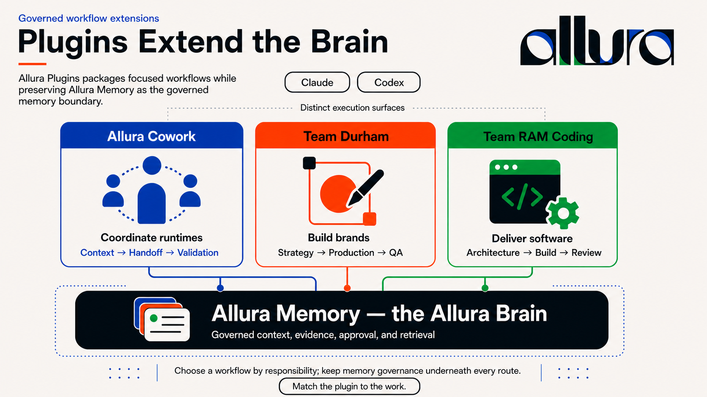
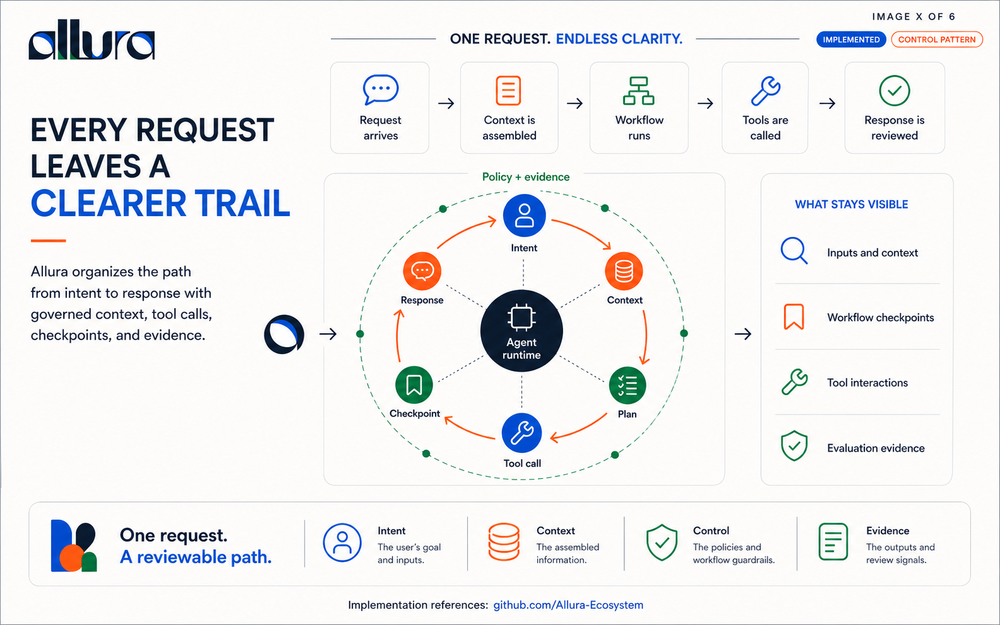
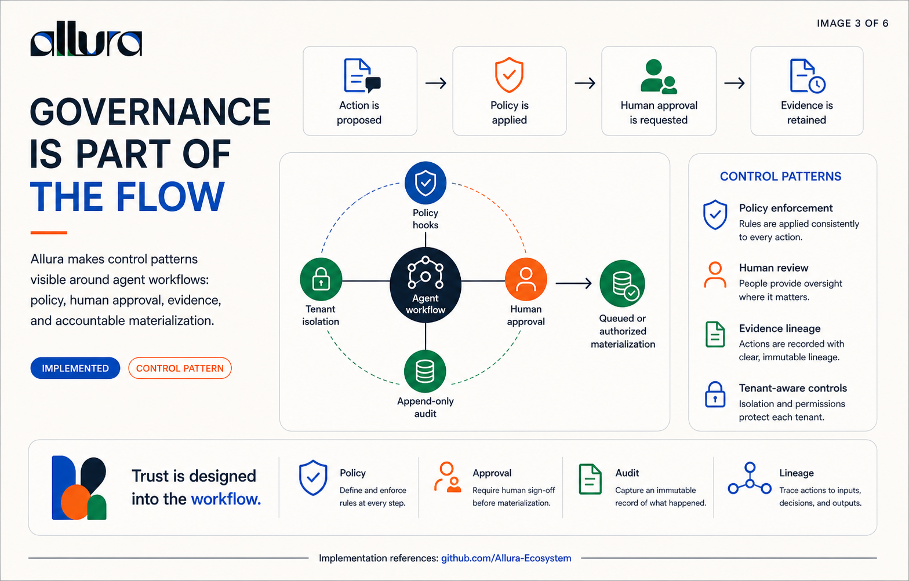

<p align="center">
  
</p>

<h1 align="center">Allura Plugins</h1>

<p align="center">
  <strong>Governed agent teams for coordination, brand production, and software delivery.</strong><br/>
   One organization-owned catalog for Claude, Codex, and Hermes plugin packages, model policy, and validation tooling.
</p>

<p align="center">
  <a href="#catalog">Catalog</a> ·
  <a href="#installation">Installation</a> ·
  <a href="#how-the-plugins-fit-together">Architecture</a> ·
  <a href="#model-governance">Model governance</a> ·
  <a href="#validation">Validation</a> ·
  <a href="#repository-map">Repository map</a>
</p>

---

<p align="center">
  <a href="docs/images/infographic-plugin-system-v3.png"></a><br/>
  <sub><a href="docs/images/infographic-plugin-system-v3.png">Open the full-size infographic</a></sub>
</p>

## What this repository owns

`allura-plugins` is the **distribution catalog and release-governance repository** for the Allura plugin layer. Standalone repositories own Team RAM, Team Durham, Mortagate, and Allura Memory source. This catalog has three jobs:

1. **Generated plugin catalog** — publish pinned exports and preserve consumer-facing install aliases without becoming their source authority.
2. **Model governance** — audit source-owned model bindings and configured-host inheritance without rewriting generated agents.
3. **Release evidence** — prove source SHAs, export drift, manifests, commands, examples, hooks, evals, secret scans, and runtime-specific package checks before a plugin is treated as ready.

Machine-readable pins live in [`source-locks.json`](source-locks.json). [`harness-sync.sh`](harness-sync.sh) only moves content from a public standalone repository at its locked full SHA into a generated catalog destination. Generated package files are not authoritative and must not be edited manually.

Plugins add skills, commands, and operating roles. They do not replace Allura Brain or bypass its memory governance.

## Catalog

The current plugin setup update is published on `codex/hermes-plugin-setup-20261018`, based on the pinned `codex/persona-rollout-20261018` release. Existing default branches are unchanged. The [earlier native rollout receipt](evidence/native-rollout-2026-10-13.json) records historical installation checks; it does not certify installation of these new packages. The standalone [Allura Framework](https://github.com/Allura-Ecosystem/allura-framework) is a separate private repository with offline agent/workflow/project authoring; access requires repository permission.

The Claude and Codex marketplaces share four versioned portable packages. Claude additionally lists three skill packages that also register natively in Hermes: Prompt Optimization Bot, CorpLawyer Bot, and Team Durham App Audit. The repository also ships one Hermes-native provider and one runtime-neutral Microsoft Cowork export. Counts below are generated/source definitions measured from the current repository tree; they are not counts of agents currently installed, loaded, or running.

| Plugin | Release metadata | Agent definitions | Command definitions | Skill definitions | Purpose |
|---|:---:|---:|---:|---:|---|
| [Allura Cowork](allura-cowork/README.md) | 0.3.1 | 1 | 4 | 1 | Coordinate Claude and Codex with hydration, honest attribution, evidence, handoff, and closeout |
| [Team Durham](team-durham/README.md) | 0.4.2-persona.20261018 | 7 | 22 | 77 | Generated export for brand strategy, visual production, accessibility, and QA |
| [Team RAM Coding](team-ram-coding/README.md) | 0.6.1-persona.20261018 | 10 | — | 10 | Generated export for Brooks-led architecture, recon, implementation, review, and validation |
| [Bumblebee](bumblebee/README.md) | 0.1.1 | — | 1 | 1 | Pinned read-only supply-chain evidence review; no scanner installation implied |
| [Hermes Allura Brain](plugins/hermes-allura-brain/README.md) | 0.3.0 | — | 1 | — | Hermes-native governed recall and outcome persistence provider |
| [Prompt Optimization Bot](plugins/prompt-optimization-bot/README.md) | 0.33.2 | — | — | 1 | Owner-supplied prompt refinement instructions for Hermes and Claude |
| [CorpLawyer Bot](plugins/corplawyer-bot/README.md) | 0.8.1 | — | — | 1 | Owner-supplied corporate-law tool planning instructions for Hermes and Claude |
| [Team Durham App Audit](plugins/team-durham-app-audit/README.md) | 1.0.1 | — | — | 1 | Read-only STP-gated brand and UX audit for Hermes and Claude |
| [Mortagate Cowork](packages/mortagate-cowork/README.md) | 0.2.1 | — | — | 4 | Pinned 23-file Microsoft Cowork package export; not a Claude/Codex marketplace plugin |

Team Durham is pinned at `0.4.2-persona.20261018`; Team RAM package and runtime versions are aligned at `0.6.1-persona.20261018`. Codex requires the `team-ram-coding` manifest name to match the catalog alias; the standalone Claude manifest retains `team-ram-harness`. Source locks record both identities. CI validates pinned source identities and native Codex manifest compatibility. Team RAM exposes ten public skills rather than its retired internal command tree; Durham retains its command definitions. Codex discovers workflows through skills.

Team Durham exports seven canonical roles. Source counts do not establish installation or execution.

Mortagate Cowork targets Microsoft Cowork's app-package and Agent Skills contract. It is linked from this runtime-neutral catalog README but is intentionally absent from the Claude and Codex marketplaces.

Hermes Allura Brain is a Hermes-native provider declared by `plugins/hermes-allura-brain/plugin.yaml`; it is intentionally not listed in the Claude marketplace because it does not implement the Claude/Codex package-manifest contract.

[Team RAM + Team Durham for Hermes](https://github.com/Allura-Ecosystem/hermes-team-ram-durham) is a separate native plugin, linked here rather than generated into this catalog or registered in its Claude/Codex marketplaces. Its `1.2.0` upgrade is published on [`codex/adaptive-hermes-teams`](https://github.com/Allura-Ecosystem/hermes-team-ram-durham/tree/codex/adaptive-hermes-teams); the default branch is unchanged. The source update is tracked in [PR #1](https://github.com/Allura-Ecosystem/hermes-team-ram-durham/pull/1). See [Hermes team usage](#hermes-team-ram--team-durham) below.

The `allura/` directory is a local Codex README asset and guidance pack. It is not listed as a public Claude marketplace package and remains internal support material. Its manifest placeholders have been resolved; this upgrade does not publish it.

### Allura Cowork

Use Allura Cowork when a task crosses Claude and Codex or needs a durable runtime handoff.

```text
Hydrate project + Brain
    ↓
Name the active runtime
    ↓
Route work and define evidence
    ↓
Create/validate handoff
    ↓
Close with outcome + remaining risk
```

Its core promise is runtime honesty: adopting a named perspective is not the same as executing a real second runtime or subagent.

### Team Durham

Team Durham is the brand-production system. Its canonical route is:

```text
Brief → strategy → positioning → verbal identity
      → visual direction → production → accessibility → QA
```

The agent roster covers orchestration, strategy, copy, visual direction, brand systems, evidence, QA, and operational trust. Optional integrations support Figma, Penpot, image generation, Notion, and document production.

### Team RAM Coding

Team RAM Coding is the governed software-delivery system. Brooks owns conceptual integrity and routing; Scout loads context; Woz implements; Pike and Fowler review interfaces and change safety.

```text
Brooks → Scout → Allura Brain → required skills
       → build/review → validate → log
```

The plugin includes task management, code review, multi-source research, MCP orchestration, security policy, secret-handling, and multi-agent dispatch skills.

## How the plugins fit together

<p align="center">
  <a href="docs/images/allura-agent-runtime.png"></a>
</p>

The runtime keeps intent, workflow, tools, memory, and response distinct so a
plugin can coordinate work without pretending that every execution surface is
the same system.

### Source ownership

| Capability | Standalone source authority | Catalog role |
|---|---|---|
| Engineering agent harness | [Allura Team RAM](https://github.com/Allura-Ecosystem/allura-team-ram) | Generated `team-ram-coding/` distribution with a compatibility install alias |
| Brand-production harness | [Team Durham](https://github.com/Allura-Ecosystem/team-durham) | Generated `team-durham/` distribution |
| Mortgage evidence-review Cowork package | [Mortagate](https://github.com/Allura-Ecosystem/mortagate) | Generated runtime-neutral `packages/mortagate-cowork/` distribution |
| Native Hermes team roles | [Hermes Team RAM + Durham](https://github.com/Allura-Ecosystem/hermes-team-ram-durham) | External standalone link; no generated bundle or portable marketplace entry |
| Governed memory | [Allura Memory](https://github.com/Allura-Ecosystem/Allura_Memory) | Linked dependency/provider surfaces; its source is not owned here |

The standalone repositories own content, contracts, and release exporters. This repository owns source locks, generated distribution paths, marketplace compatibility identities, catalog-level policy, and release verification.

| Need | Lead plugin | Supporting plugin |
|---|---|---|
| Cross-runtime collaboration | Allura Cowork | Team RAM Coding or Team Durham executes the domain work |
| Product or engineering work | Team RAM Coding | Cowork handles runtime handoff |
| Brand strategy and production | Team Durham | Cowork handles runtime handoff |
| Persistent project context | Allura Brain connection | Every plugin follows the same scoped memory rules |

The plugins are composable but keep distinct ownership:

- **Cowork coordinates.**
- **Durham creates and protects brand intent.**
- **Team RAM Coding builds and validates software.**
- **Allura Brain remembers and governs.**
- **Hermes Allura Brain connects Hermes to governed recall and outcome persistence.**

## Shared operating contract

<p align="center">
  <a href="docs/images/allura-governance-flow.png"></a>
</p>

All catalog plugins inherit the same Allura expectations:

- search relevant project context before substantive work;
- use `group_id: allura-system` unless the project declares another valid `allura-*` tenant;
- treat raw episodic traces as evidence, not canonical truth;
- identify the actual runtime and never claim an agent or tool executed when it did not;
- preserve approval boundaries for secrets, production, scheduling, promotion, and destructive actions;
- validate the result before calling work done;
- write a factual outcome receipt after substantive work when Allura Brain is available.

## Installation

### Claude marketplace

```text
/plugin marketplace add Allura-Ecosystem/allura-plugins
/plugin install allura-cowork@allura-ecosystem
/plugin install team-durham@allura-ecosystem
/plugin install team-ram-coding@allura-ecosystem
```

The Claude catalog is defined in [`.claude-plugin/marketplace.json`](.claude-plugin/marketplace.json). Each package also owns its own `.claude-plugin/plugin.json`. Hermes uses its native provider manifest instead; follow [its package README](plugins/hermes-allura-brain/README.md).

### Codex

Each catalog package contains a `.codex-plugin/plugin.json` manifest. The repository does not itself prove that a given Codex build accepts, installs, or loads every declared surface. For a compatible Codex environment, clone this repository into your plugin source location, register the package through that environment's supported local-plugin flow, and verify it appears after restart.

The root [`.agents/plugins/marketplace.json`](.agents/plugins/marketplace.json) lists the portable catalog packages. Catalog membership does not establish installation or loading in a particular Codex session.

### Hermes: Team RAM + Team Durham

The external [native team plugin](https://github.com/Allura-Ecosystem/hermes-team-ram-durham)
uses the Hermes identity `team-ram-durham`. Its published upgrade branch is
`codex/adaptive-hermes-teams`; a default-branch install is not an upgrade-branch install.
Version `1.2.0` exports ten RAM roles and seven Durham roles. The following describes the native conversation-routing implementation:

```text
/ram activate
/ram <task>
/durham <task>
/ram-woz <task>
/durham-copywriter <task>
```

On RAM activation or an explicit menu request, the adapter loads the canonical
chat menu and recommends the next applicable step: Setup, Doctor, Work, then
Review. Ordinary work does not repeat the menu.

The native `allura_team` tool loads role and workflow guidance for the current
conversation. The active agent then carries out the task with the configured model
and existing permissions. Loading guidance does not start a subprocess, override the
model, or prove that work has been executed.

Slash commands queue work through the installed Hermes CLI's message-injection
support. Gateway surfaces without that support return a fallback instruction;
send a normal prompt such as: “Use `allura_team` with team `ram`, role `woz`, and
task `<task>`, then continue here.” Use team `durham` and role `copywriter` for
brand copy work.

Bundled skills register actual `SKILL.md` files under
`team-ram-durham:ram-<name>` and `team-ram-durham:durham-<name>`, keeping the two
teams' names separate. Entry workflows are `team-ram-durham:ram` and
`team-ram-durham:durham`.

[Hermes Allura Brain](plugins/hermes-allura-brain/README.md) remains the separate
memory provider. The team plugin does not install or reconfigure it. Brain calls
use explicit tenant scope: RAM `allura-system`, Durham `allura-team-durham`.
Unavailable scoped memory is reported honestly; no provider-default tenant fallback
is implied.

### Requirements

| Requirement | Applies to |
|---|---|
| A compatible Claude Code or Codex plugin environment | Targeted by the package manifests; verify loading in the actual runtime |
| Allura Brain MCP connection | Expected for governed hydration and outcome logging |
| Python 3 | Allura Cowork hooks and validation scripts |
| Docker | Optional MCP Docker, secret, and infrastructure workflows |
| Figma, Penpot, Notion, fal.ai, LibreOffice | Optional Team Durham integrations only |

Missing optional integrations should degrade visibly and leave the core plugin loadable.

## Updating the catalog

The default command and `--dry-run` both run read-only local metadata, manifest,
and model audits. They do not install plugins or modify runtime caches or user settings.

```bash
bash scripts/plugins-update-all.sh
bash scripts/plugins-update-all.sh --dry-run
```

To also verify a pinned export against committed local source, supply its source ID
and checkout. Audit mode requires a local binding for every selected export:

```bash
bash scripts/plugins-update-all.sh --dry-run --package team-ram \
  --source team-ram=/path/to/allura-team-ram
```

Explicit `--sync` regenerates selected repository exports from the locked commits,
synchronizes repository marketplace metadata, and reruns validation:

```bash
bash scripts/plugins-update-all.sh --sync --package team-ram \
  --source team-ram=/path/to/allura-team-ram
```

Repeat `--package` and `--source` to select additional source exports. Without a
local binding, explicit sync may fetch the locked source repository. Source pins
must be published separately before remote consumers can fetch them. The updater
never installs the external Hermes team plugin, pulls installed marketplaces, clears
caches, restarts runtimes, or rewrites user configuration. Runtime installation
flags such as `--runtime` are rejected; use `--help` for the supported options.

## Model governance

[`docs/models.yaml`](docs/models.yaml) defines catalog policy and points to the
owning source registries. Agents inherit the configured host model by default.
Explicit supported overrides belong in canonical source, followed by validation,
a new commit pin, and export regeneration. The catalog never rewrites generated
agent bindings or installed copies.

```bash
bash scripts/models-update-all.sh --dry-run
bash scripts/models-eval.sh --dry-run
bash scripts/models-performance.sh --dry-run
```

The first command audits inheritance. The other two print benchmark plans with
`status: not-run`; without `--dry-run` they return an error because no benchmark
execution or telemetry backend is configured by these scripts. They do not produce
simulated success, token costs, or performance measurements. Compare candidate models
using actual accepted outcomes, retries, latency, cost, and review evidence under
matching task conditions.

## Validation

### Catalog checks

| Command | What it checks |
|---|---|
| `bash scripts/commands-audit.sh` | Orphan commands, manifest format, frontmatter, and cross-plugin collisions |
| `bash scripts/models-update-all.sh --dry-run` | Model assignment drift without mutation |
| `bash scripts/models-eval.sh --dry-run` | Benchmark plan only; no evaluation is executed |
| `bash scripts/plugins-update-all.sh --dry-run` | Read-only local metadata, manifest, and model audits |
| `./harness-sync.sh --check` | Public source commit availability, deterministic regeneration, provenance, versions, aliases, forbidden files, and byte/hash drift |
| `gitleaks detect --no-git --source . --config .gitleaks.toml` | Generated-output and catalog secret scan |

CI runs the source-export verifier, manifest validator, command audit, JSON/YAML/shell parsing, gitleaks, and package smoke checks. Model benchmark plans are not execution evidence. Native runtime installation and behavioral checks remain separate from catalog audits.

### Current CI coverage

The [`.github/workflows/ci.yml`](.github/workflows/ci.yml) checks:

- every locked public source commit can be cloned and regenerated through its canonical exporter/contract with no catalog drift;
- provenance, allowlists, per-file hashes, generated-file inventories, runtime distinctions, compatibility aliases, and applicable version parity;
- the Claude marketplace parses and each listed source resolves inside the repository;
- the Hermes-native `plugins/hermes-allura-brain/plugin.yaml` declares a valid `allura-brain` provider identity, version, and description;
- Claude marketplace versions match the corresponding Claude `plugin.json` versions;
- explicitly listed Claude agent paths and all declared Claude command paths exist; list-valued agent manifests and top-level command directories have no on-disk orphans, and nested command definitions are rejected;
- shipped marketplace plugin directories do not contain the workflow's machine-path patterns or prohibited embedded runtime-config directories;
- repository JSON parses, YAML loads, and shell scripts pass `bash -n`;
- the root README and LICENSE exist; and
- gitleaks reports no unallowlisted findings across the entire checked-out catalog;
- command audits and package-specific Allura Cowork/Mortagate smoke checks pass.

CI cannot prove optional external integrations, native installation into every locally available runtime, or live cross-runtime behavioral parity. Those require release-environment evidence; CI does not turn a structural package check into a runtime-execution claim.

### Package checks

Allura Cowork:

```bash
python3 allura-cowork/scripts/validate_plugin.py allura-cowork
python3 allura-cowork/scripts/run_evals.py allura-cowork
```

Team Durham's validation skills and Team RAM Coding's review gates are documented in their package READMEs and skill folders. These are available validation definitions, not evidence that CI ran them. A manifest parsing successfully is necessary, but it is not sufficient evidence that every command, hook, dependency, runtime, or external integration works.

### Definition of ready

A generated plugin release is ready for catalog review only when:

1. the standalone source repository and exact public full SHA are locked;
2. its canonical manifest/contract and exporter regenerate the destination with zero drift or unexpected files;
3. generated provenance and per-file inventories required by the source contract validate;
4. Claude/Codex manifests and marketplace aliases resolve without modifying generated source identities;
5. applicable marketplace/runtime/package versions match the machine-readable lock;
6. commands, JSON, YAML, shell, package smoke, and gitleaks checks pass;
7. optional dependencies, degraded behavior, exclusions, and runtime distinctions are documented; and
8. runtime-ready claims beyond CI are backed by evidence from the actual target runtime.

## Plugin anatomy

```text
<plugin>/
├── .claude-plugin/plugin.json   Claude package manifest
├── .codex-plugin/plugin.json    Codex package manifest
├── agents/                      specialist role definitions
├── commands/                    user-invoked workflows
├── skills/                      reusable operating instructions
├── hooks/                       optional lifecycle hooks
├── scripts/                     validation and package tooling
├── evals/                       behavior fixtures
└── README.md                    package-specific contract
```

Not every package needs every directory. Keep the manifest surface as small as the product requires.

## Repository map

```text
allura-plugins/
├── .claude-plugin/marketplace.json   Claude marketplace catalog
├── .agents/plugins/marketplace.json  Codex portable marketplace catalog
├── allura-cowork/                    coordination and handoff plugin
├── team-durham/                      generated Team Durham distribution
├── team-ram-coding/                  generated Team RAM distribution (compatibility alias)
├── packages/mortagate-cowork/        generated Microsoft Cowork distribution (not Claude marketplace)
├── plugins/hermes-allura-brain/       Hermes-native Allura Brain provider
├── source-locks.json                  public repo/SHA/export/runtime/alias locks
├── harness-sync.sh                    pinned source -> catalog check/sync entrypoint
├── _bmad/bmm/                         catalog-local epics and stories
├── allura/                           internal README asset/guidance pack
├── docs/models.yaml                  source-owned model policy
├── docs/images/                      README brand assets
├── scripts/                          update, audit, and eval tooling
└── evals/fixtures/                   shared evaluation fixtures
```

## Contributing

- Make Team RAM, Team Durham, Mortagate, and Allura Memory content changes in their standalone owning repositories, never in generated catalog exports.
- Update both Claude and Codex manifests in the standalone source when that public surface changes, then regenerate.
- Add commands explicitly rather than relying on broad globs.
- Keep secrets and credentials out of manifests, prompts, examples, and test output.
- Preserve user changes in dirty worktrees.
- Run the narrowest relevant validation first, then the catalog checks.
- Document external dependencies as optional unless the plugin cannot function without them.

## Brand system

The plugin catalog uses the canonical Allura visual language:

- Allura Blue `#0D47A1` — intelligence and coordination
- Allura Orange `#FF4D1F` — clarity and creative decision
- Allura Green `#14BA4B` — connection and delivery
- Allura Ink `#0F1720` — technical structure
- Allura Cream `#F7F3EE` — readable editorial space
- Aeonik — display, heading, and body typography
- IBM Plex Mono — code and technical identifiers

## License

MIT — see [LICENSE](LICENSE).

---

<p align="center">
  <strong>Coordinate clearly. Create deliberately. Build with evidence.</strong>
</p>

## Adaptive workflow upgrade

See [release evidence and rollout boundaries](docs/ADAPTIVE-RELEASE.md) for risk-based
routes, context reuse, model inheritance, source pins, and validation limits.
The catalog model scripts audit source-owned bindings; they never rewrite generated
agents or report simulated benchmarks as successful model evaluations.
