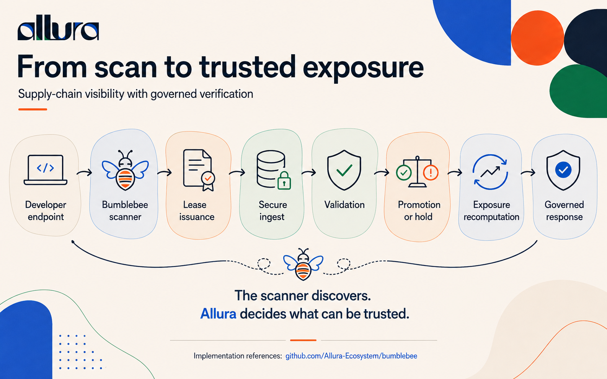
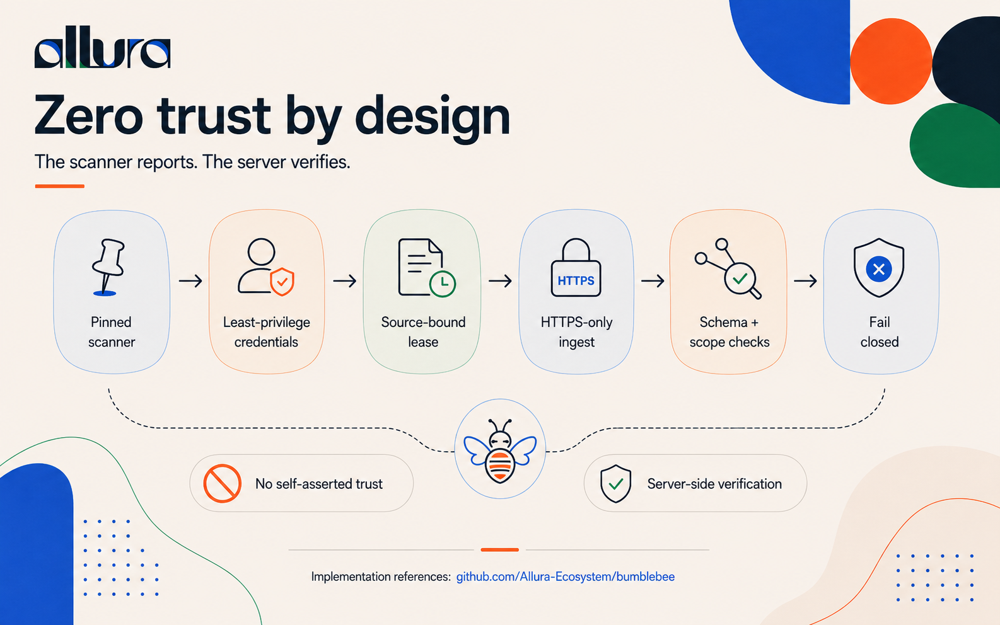
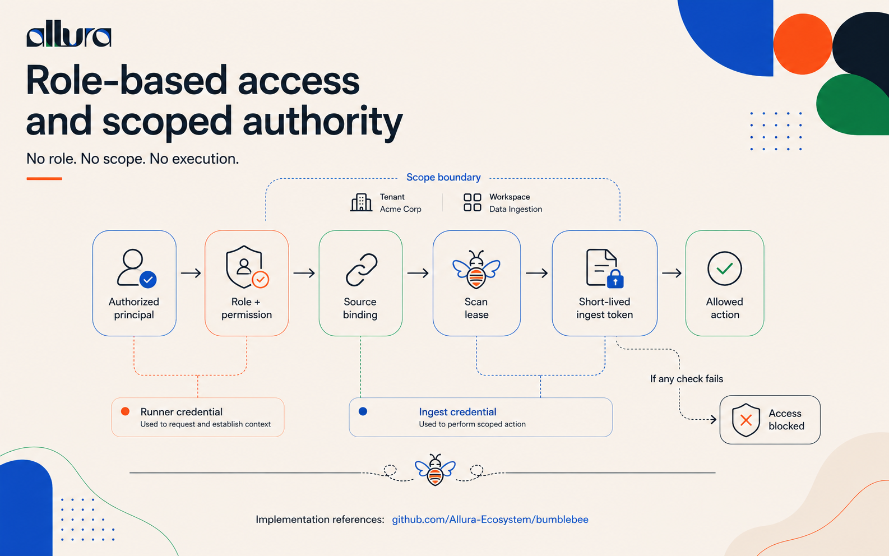
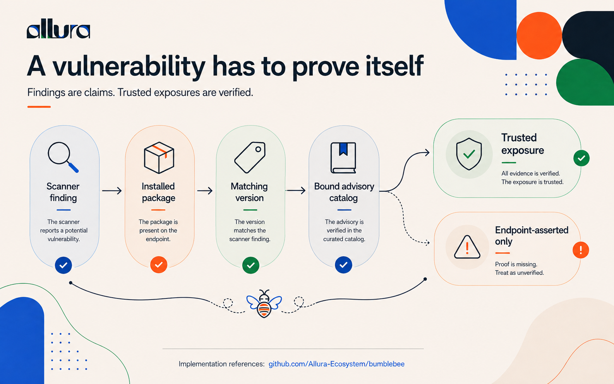
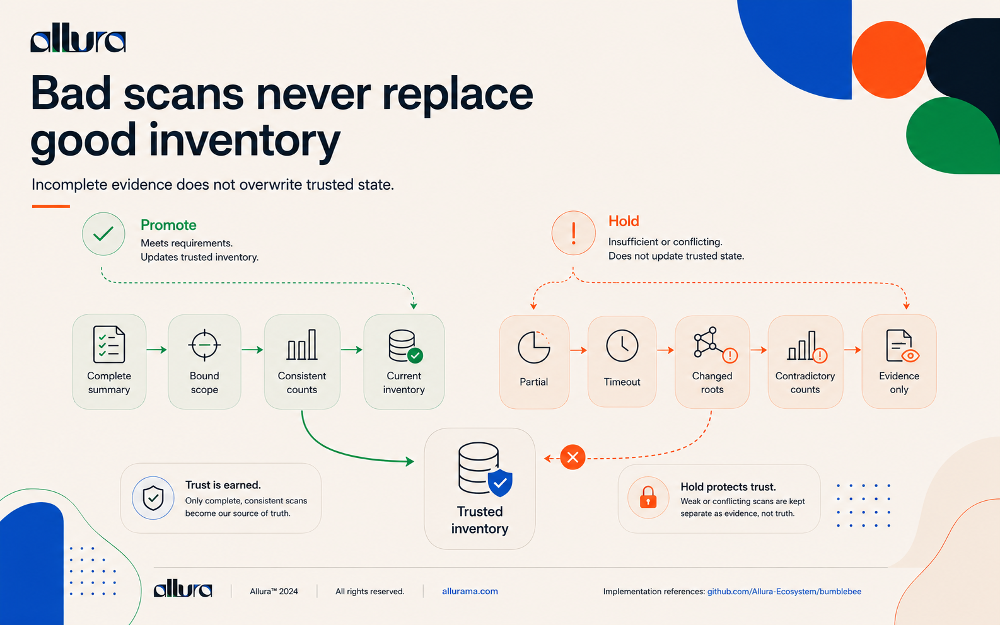
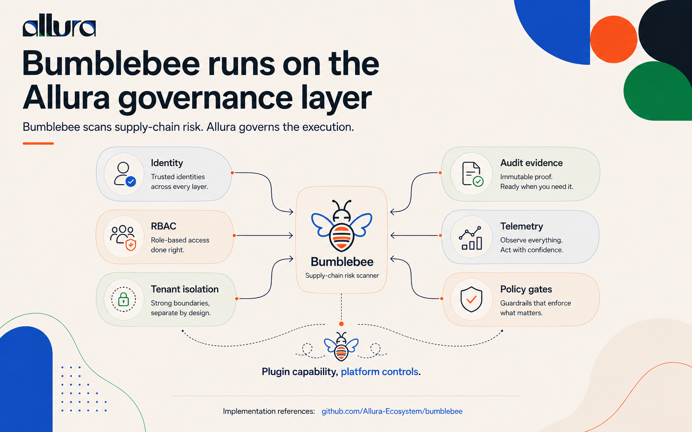

# Bumblebee Plugin — Supply-Chain Threat Intelligence

> **AI-Assisted Documentation** — prepared with AI assistance and grounded in the pinned upstream source, repository authority, and live code review (Epic 26, Story 26.7, all 19 ACs approved 2026-08-29).

## Plugin workflow update — 0.1.1

The shipped `bumblebee-review` skill and command now provide a direct entry point
for read-only evidence review. They reuse matching, fresh context and inherit the
user's model choice. Stale evidence and changed scope force a refresh. The plugin
still supplies no scanner binary or live connector; server governance and the
upstream scanner pin are unchanged. See [workflow evaluation](docs/workflow-evaluation.md).

## What It Is

The Bumblebee plugin is a **governed agent-tool integration** built on Allura's framework and harness primitives. It wraps a pinned upstream scanner — [`perplexityai/bumblebee`](https://github.com/perplexityai/bumblebee) — as a deterministic, policy-gated tool within the Allura agent platform, providing read-only supply-chain inventory and vulnerability exposure intelligence for developer endpoints.

The upstream scanner is a Go binary that performs one-shot metadata scans (`baseline`, `project`, `deep`) of developer machines and emits NDJSON records (packages, findings, diagnostics, and a trailing `scan_summary`). The Allura plugin owns the agent-framework layer around that scanner: scoped tool credentials, deterministic execution pipeline, policy hooks at each stage, tenant/workspace binding, durable snapshot state, eval-conformance validation, and downstream handoff to Allura's exposure and governed-response services.

The plugin follows a **zero-trust architecture**: the scanner is never trusted to self-assert scope, credentials are least-privilege and audience-bound, every signal is verified server-side before processing, and all failures fail closed. TLS termination is handled at the edge (Cloudflare tunnel), with the plugin enforcing HTTPS-only ingestion behind the proxy via explicit trusted-proxy scheme handling.

This is one instance of Allura's broader framework patterns — see [Framework Mapping](docs/framework-mapping.md) for how bumblebee's design maps to the platform's reusable agent orchestration, memory, harness, and governance capabilities.

## Why It Exists

Supply-chain security requires knowing what packages are installed across developer endpoints, which of those packages have known vulnerabilities, and whether that exposure is current or stale. The upstream Bumblebee scanner answers the first question; the Allura plugin answers the rest by composing the platform's framework primitives:

1. **Agent tool-calling pattern** — the scanner is registered as a governed tool with scoped credentials (`bumblebee_runner` → lease → `bumblebee_ingest`), mirroring how Allura's `mcp/` and `agents/` modules handle tool invocation with lease-bound authority.
2. **Deterministic execution pipeline** — the 9-step ingest pipeline (`ingest-pipeline.ts`) is a deterministic workflow with fail-closed gates at each stage, using the same patterns as Allura's `process-engine/` and `harness/` modules.
3. **Policy hooks** — the promotion engine (`promotion-engine.ts`) is a reusable evaluation harness that applies 10 policy checks before accepting agent output, mirroring Allura's `guard/` gateway and `governance/` policy patterns.
4. **Eval integration** — 17 test files including adversarial conformance tests that validate agent outputs against schema contracts, using Allura's `evals/` and `harness-adapter/` primitives.
5. **Memory and state** — durable evidence ledger with append-only records, immutable receipts, and staleness semantics, built on Allura's `memory/` and `db/` tenant-scoped transaction patterns.
6. **Framework composability** — the module manifest (`module.ts`) registers with the Curator module registry (`curator/module-registry.ts`), using the same composability contract that `adapter-registry/` and `harness-adapter/` provide for other agent integrations.

---

## How It Works

### 1. From scan to trusted exposure

  

**Developer endpoint** → **Bumblebee scanner** → **lease issuance** → **secure ingest** → **validation** → **promotion or hold** → **exposure recomputation** → **governed response**. The scanner discovers; Allura decides what can be trusted.

| Stage | Code | What happens |
|---|---|---|
| Lease issuance | `lease-authority.ts` | Runner authenticates with `bumblebee_runner`; server mints a short-lived `bumblebee_ingest` token bound to source revision and population contract |
| Secure ingest | `ingest-pipeline.ts` | HTTPS-only, auth before body parse, content-type and encoding gates, bounded read, replay and conflict detection |
| Validation | `batch-conformance.ts` | NDJSON record validation, canonical ID recomputation, sanitization, size limits |
| Promotion or hold | `promotion-engine.ts` | 10-check evaluation matrix; atomic persist of receipt, records, and decision |
| Exposure recomputation | `finding-authority.ts` | Server-side finding → package → catalog matching with evidence junctions |

---

### 2. Zero trust by design

  

The scanner reports. The server verifies. A **pinned scanner** (`v0.1.2`, enforced in `upstream-contract.ts`), **least-privilege credentials**, a **source-bound lease**, **HTTPS-only ingest**, and **schema plus scope checks** precede every write — and anything that fails **fails closed**. No self-asserted trust reaches state.

---

### 3. Role-based access and scoped authority

  

No role. No scope. No execution. The credential split is deliberate: the **runner credential** requests and establishes context, and a separate **ingest credential** performs the scoped action. **Source binding** and a **short-lived ingest token** keep every action inside its tenant and workspace boundary. If any check fails, access is blocked rather than degraded.

---

### 4. A vulnerability has to prove itself

  

Findings are claims; trusted exposures are verified. A scanner finding becomes a **trusted exposure** only after the **installed package** is confirmed present on the endpoint, the **version matches** the finding, and the advisory is verified against the **bound advisory catalog**. Anything short of that stays **endpoint-asserted only** — recorded, but never presented as proven.

---

### 5. Bad scans never replace good inventory

  

Incomplete evidence does not overwrite trusted state. A scan is **promoted** only when it carries a complete summary, bound scope, and consistent counts. Partial results, timeouts, changed roots, and contradictory counts are **held as evidence only** — the current inventory is preserved untouched. Trust is earned; hold protects it.

---

### 6. Bumblebee runs on the Allura governance layer

  

Bumblebee scans supply-chain risk; Allura governs the execution. **Identity**, **RBAC**, and **tenant isolation** shape who may act; **audit evidence**, **telemetry**, and **policy gates** shape what that action is allowed to become. Plugin capability, platform controls.

Downstream, exposure alerts flow into simulated proposals, approvals, actions, and immutable receipts, with optional read-only display on the Curator dashboard.

## Code Location

This repository is the **public plugin and documentation surface** for bumblebee. The implementation lives in [`Allura_Memory`](https://github.com/Allura-Ecosystem/Allura_Memory); every path below is relative to that repository, not this one.

| Surface | Path |
|---------|------|
| Core library | `src/lib/bumblebee/` |
| API routes | `src/app/api/plugins/bumblebee/{runs,ingest}/` |
| Curator UI surfaces | `src/components/bumblebee/surfaces.tsx` |
| Tests | `src/lib/bumblebee/__tests__/` (17 test files) |
| Planning docs | `_bmad/bmm/planning/epic-26-*.md` |
| Sprint status | `_bmad/bmm/stories/sprint-status.yaml` (Epic 26 = done) |

## Source Files at a Glance

Paths below are under `src/lib/bumblebee/` in [`Allura_Memory`](https://github.com/Allura-Ecosystem/Allura_Memory).

| File | Responsibility |
|------|---------------|
| `module.ts` | Plugin manifest — immutable descriptor, feature flag, capability assertions |
| `upstream-contract.ts` | Pinned upstream scanner version, schema version, ecosystem allowlists, scan contract validation |
| `source-authority.ts` | Source enrollment — immutable source revision with scanner pin, scope, classification, redaction policy |
| `lease-authority.ts` | Scan lease issuance — runner auth, short-lived ingest token minting, HMAC token hashing |
| `lease-routes.ts` | HTTP route handlers — shared auth/error mapping for runs + ingest endpoints |
| `lease-repository.ts` | Production wiring — DB-backed credential bootstrap, tenant-scoped transactions, ingest store factory |
| `batch-conformance.ts` | NDJSON parsing — record validation, canonical ID recomputation, sanitization, size limits |
| `ingest-pipeline.ts` | Ingestion orchestration — auth→gates→replay→conflict→conformance→atomic persist |
| `batch-store.ts` | Atomic batch persistence — receipt + records + held decision in one transaction |
| `promotion-engine.ts` | Snapshot promotion — 10-check evaluation matrix, deterministic decision persistence |
| `staleness.ts` | Profile separation (baseline/project = routine, deep = campaign) and freshness TTL |
| `finding-authority.ts` | Exposure recomputation — server-side finding→package→catalog matching, evidence junctions |
| `exposure-store.ts` | Exposure projection — DB queries for current packages, catalog entries, and exposure persistence |

## Upstream Scanner Pin

| Field | Value |
|-------|-------|
| Repository | `perplexityai/bumblebee` |
| Tag | `v0.1.2` |
| Commit | `cc57710eeaf685e7b89924a36c8583cad0a378fe` |
| Tree | `985f57cf1749c15561c886c4476f10950ffa9cae` |
| Schema version | `0.1.0` |
| License | Apache-2.0 |

The pin is enforced in code at `upstream-contract.ts` → `BUMBLEBEE_UPSTREAM_PIN` and validated on every source revision creation in `source-authority.ts`.

## Status

- **Epic 26**: Done (all 19 ACs approved 2026-08-29, unanimous Pike/Fowler/Knuth review)
- **Sprint**: Story 26.7 complete — live PostgreSQL 115/115, unit 2450, typecheck clean
- **Feature flag**: `BUMBLEBEE_MODULE_ENABLED=true` (default-off, exact true only)

## Further Reading

- [Framework Mapping](docs/framework-mapping.md) — how bumblebee maps to Allura's reusable agent framework, harness, memory, and governance primitives
- [Architecture & Data Flow](docs/architecture.md) — module structure, data model, promotion matrix
- [Transport & Auth](docs/transport.md) — API endpoints, credential split, HTTPS enforcement
- [Upstream Pin & Schema](docs/upstream-pin.md) — scanner version, ecosystem allowlists, compatibility restrictions
- [State & Promotion](docs/state-model.md) — snapshot truth, staleness, profile separation
- [Security & Privacy](docs/security.md) — sanitization, RLS, fail-closed patterns, secret canaries